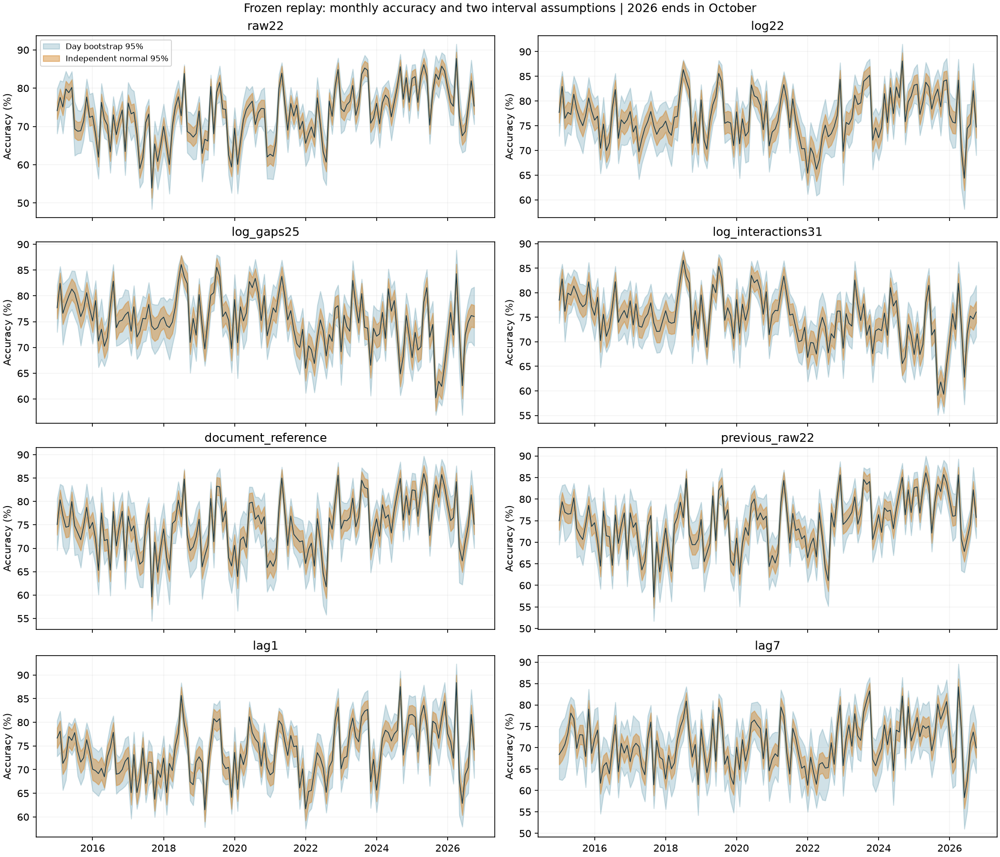

# Logistic Regression for NSW Price Direction

This directory contains the P4 price-direction experiments. Each model predicts whether the NSW electricity price in each of the next day's 48 half-hour intervals will exceed the previous market day's mean price. The target is `nsw_price_up`, with values 0 and 1.

All experiments use the course dataset and a pipeline consisting of `StandardScaler` and L2-regularised `LogisticRegression`. The study covers feature transformations, hyperparameter search, feature-group ablation and frozen historical replay.

## Selected model

The group selected `log_interactions31` on 15 November 2026. `PriceClassifier()` loads this model by default: C=1, no class weighting, threshold=0.42, fitted through 2014. The selected configuration is in [selected_price_model.json](handoff/selected_price_model.json). Other configurations remain as experiment records. The expanding-window training component and explicit nested probability-threshold interface are documented in [final_training.md](notes/final_training.md); tau denotes the probability threshold, selected on the last calendar year before the final expanding-window refit.

## Models and features

The starting point is the 22-feature Logistic configuration from the group's baseline ablation study. `features.py` imports `src.common.features` from main and selects these 22 columns in their original order. `transforms.py` applies the four P4 configurations below.

| Feature group | Columns |
|---|---|
| Time and calendar | `slot_sin`, `slot_cos`, `season_sin`, `season_cos`, `weekend`, `weekday_0` to `weekday_6` |
| NSW market history | `nsw_demand_lag1`, `nsw_price_lag1`, `nsw_demand_lag7`, `nsw_price_lag7`, `prev_price_mean` |
| Queensland demand | `qld_demand_lag1` |
| Rolling statistics | `nsw_demand_mean28`, `nsw_demand_std28`, `nsw_price_mean28`, `nsw_price_std28` |

The four feature configurations are:

| Configuration | Features | Definition |
|---|---:|---|
| `raw22` | 22 | Original feature values |
| `log22` | 22 | Signed-log transformation of five historical price columns |
| `log_gaps25` | 25 | `log22` plus three signed-log price gaps |
| `log_interactions31` | 31 | `log_gaps25` plus six price-gap and time-slot interactions |

The signed-log transformation is `sign(x) * log1p(abs(x))`. It is applied to `nsw_price_lag1`, `nsw_price_lag7`, `prev_price_mean`, `nsw_price_mean28` and `nsw_price_std28`. Prices are expressed in $/MWh. Negative and zero prices are retained.

The three gaps are yesterday's same-slot price, last week's same-slot price and the 28-day same-slot mean price, each minus yesterday's daily mean. Each difference is calculated on the original price scale before the signed-log transformation. The interaction configuration multiplies each transformed gap by `slot_sin` and `slot_cos`.

The 28-day statistics use the preceding 28 complete market days at the same slot. Standard deviations use `ddof=0`. Full formulas and feature ordering are documented in [the experimental protocol](notes/protocol.md).

## Training and selection

| Step | Training period | Evaluation period |
|---|---|---|
| Search fold 1 | 2010-01-29 to 2012-12-31 | January–June 2013 |
| Search fold 2 | 2010-01-29 to 2013-06-30 | July–December 2013 |
| Feature configuration selection | 2010-01-29 to 2013-12-31: 68,784 intervals | 2014: 17,520 intervals |
| Frozen-model refit | 2010-01-29 to 2014-12-31: 86,304 intervals | — |
| Historical replay | Fixed models fitted through 2014 | 2015-01-01 to 2026-10-31: 207,456 intervals |

Each feature configuration uses the same search grid:

- `C`: 0.01, 0.1, 1, 10.
- `class_weight`: `None`, `balanced`.
- Probability threshold: 0.25 to 0.60 in increments of 0.01.

This gives 288 candidates per configuration and 1,152 candidates in total. Each scaler is fitted on its fold's training data. Parameters are chosen by balanced accuracy on the pooled predictions from the two 2013 validation folds. Threshold candidates reuse the fitted model's probabilities.

The four configurations are then fitted on 2010–2013 and compared on 2014 balanced accuracy. Ties favour fewer features, followed by configuration name. The selected configuration is `log_interactions31`, with `C=1`, `class_weight=None` and threshold `0.42`.

All four configurations and two fixed reference configurations are refitted through 2014 and saved for replay. Their fitted parameters remain fixed throughout the replay period. Lagged features and rolling statistics are updated from the history available before each forecast day.

## Results

### Validation and frozen replay

| Model | C | Class weight | Threshold | 2014 BalAcc (%) | 2014 Accuracy (%) | Replay BalAcc (%) | Replay Accuracy (%) |
|---|---:|---|---:|---:|---:|---:|---:|
| Original reference | 1 | None | 0.40 | 75.7929 | 75.8390 | 74.8979 | 74.7667 |
| Initial weighted model | 1 | balanced | 0.40 | 76.1096 | 76.0217 | 74.8028 | 74.3811 |
| Tuned `raw22` | 10 | balanced | 0.33 | 74.9331 | 74.6062 | 74.2307 | 73.2194 |
| `log22` | 10 | balanced | 0.46 | 77.0323 | 77.0263 | **75.6977** | **76.9079** |
| `log_gaps25` | 1 | balanced | 0.49 | 78.5803 | 78.5445 | 74.5421 | 75.2058 |
| `log_interactions31` | 1 | None | 0.42 | **79.1249** | **79.0183** | 74.6210 | 74.9036 |
| Same slot yesterday | — | — | — | 73.9862 | 73.9041 | 73.4201 | 73.8099 |
| Same slot last week | — | — | — | 74.2818 | 74.2466 | 70.4162 | 70.8063 |

`log_interactions31` has the highest 2014 balanced accuracy, improving on the original reference by 3.332 percentage points. `log22` has the highest balanced accuracy over the full frozen replay, exceeding the yesterday baseline by 2.278 percentage points. Both models are included in the handoff for group comparison.

Validation scores use models trained through 2013; replay scores use models refitted through 2014. The replay covers 4,322 days and 142 months. The 2026 results cover January–October.

Detailed tables: [2014 validation](results/frozen/validation_2014.csv), [overall replay](results/frozen/overall.csv), [yearly scores](results/frozen/yearly.csv), [monthly scores](results/frozen/monthly.csv).

### Feature-group ablation

The group's baseline study supplies the initial feature-selection results. This directory adds ablations for the 31-feature configuration. Each reduced model is retrained with `C=1`, `class_weight=None` and threshold `0.42`, using the same training and validation intervals.

| Removed group | Remaining features | 2014 BalAcc (%) | Change from full model (pp) |
|---|---:|---:|---:|
| Calendar and associated slot interactions | 13 | 78.3082 | -0.8168 |
| NSW history and dependent gaps/interactions | 17 | 71.4698 | -7.6551 |
| Queensland demand | 30 | 79.0754 | -0.0496 |
| 28-day statistics and dependent gaps/interactions | 24 | 78.3371 | -0.7879 |

Removing a source feature also removes its dependent gap and interaction terms. The retained columns are listed in [the ablation table](results/frozen/selected_ablation_2014.csv).

Earlier searches on the original 22 features are retained in `results/tuning_checks/`. The 30-candidate search achieved 76.1096% on 2014. Expanding the search to 2,070 candidates produced a configuration with 75.3640%. Grid definitions and commands are in [the search record](notes/search_history.md).

## Metrics and figures

Accuracy is the proportion of correctly classified intervals. Balanced accuracy is the mean recall over the classes present in the evaluation period. Metrics are calculated from all intervals in each reported period. Both baselines compare their lagged price with yesterday's original daily mean price.

Monthly accuracy includes two 95% intervals:

- Independent half-hour normal approximation: `100 * (p ± 1.96 * sqrt(p * (1-p) / n))`.
- Whole-day bootstrap: 2,000 resamples of complete 48-interval days, using seed 17 and the 2.5th/97.5th percentiles.

Balanced accuracy uses class-specific recall variances for its independent approximation and the same day-bootstrap procedure. Paired comparisons resample the same days for both models.

The normal approximation assumes independent intervals. The day bootstrap preserves dependence within each day and treats days as exchangeable. Cross-day dependence and changes across years affect the interpretation of these intervals. The 2014 comparisons share the feature-selection data and have no multiple-comparison adjustment.



Additional figures cover [yearly balanced accuracy](results/frozen/yearly_balacc.png), [monthly class proportions](results/frozen/class_balance.png), [yearly observed class proportions](handoff/yearly_class_share.png), and [observations against predicted probabilities](results/frozen/observed_vs_predicted.png).

## Running the experiments

Use Python 3.11 and run these commands from the latest main repository root, with both `src/common/features.py` and `logistic_price/` present. Place the course CSV under `data/`, or supply its path with `--data`.

```sh
python -m pip install -r logistic_price/requirements.txt

python -m logistic_price.study \
  --data data/nem_weather_halfhourly_2010_2026.csv \
  --output logistic_price/_scratch/reproduction

python -m logistic_price.verify \
  --data data/nem_weather_halfhourly_2010_2026.csv \
  --results logistic_price/_scratch/reproduction

python -m logistic_price.selfcheck

python -m logistic_price.verify_integration \
  --data data/nem_weather_halfhourly_2010_2026.csv \
  --results logistic_price/results/frozen \
  --report logistic_price/_scratch/v1_check.json
```

Each study run requires a new output directory. The committed reference results are under `results/frozen/`. `_scratch/` is used for local runs.

The reference environment is Python 3.11.18, NumPy 2.4.6, pandas 3.1.0, SciPy 1.17.1, scikit-learn 1.9.1 and joblib 1.6.0. The selected model's daily interface was checked against batch predictions for all 4,322 replay days. A complete repeat run reproduced all 14 result CSV files exactly. Further checks are recorded in [checks.md](notes/checks.md).

## Files and outputs

| File or directory | Purpose |
|---|---|
| `study.py` | Feature comparison, parameter search, refitting, replay and ablation |
| `features.py`, `transforms.py` | Base features and the four input configurations |
| `tuning.py` | Estimator construction and earlier parameter searches |
| `classifier.py` | Saved-model loading and daily prediction |
| `scoring.py`, `diagnostics.py` | Metrics, intervals, plots and prediction exports |
| `verify.py`, `verify_integration.py`, `selfcheck.py` | Result verification, shared-v1 regression checks and synthetic-data checks |
| `milestones.py` | Shared result row, yearly class proportions and model-age analysis |
| `results/frozen/` | Search tables, selected configurations, scores, figures and predictions |
| `results/frozen/artifacts/` | Six fitted pipelines and their settings |
| `results/tuning_checks/` | Earlier search results |
| `handoff/` | Shared-table row, candidate configuration and supporting analysis |
| `notes/` | Detailed protocol, checks and report-planning material |

The replay prediction file contains the observed labels, predicted classes and probabilities. `protocol.json`, `selection_2013.json`, `selection_2014.json` and `run.json` record the experiment settings, selected configurations, data checksum and environment versions.

## Model handoff

```python
from logistic_price.classifier import PriceClassifier

price_model = PriceClassifier(
    "logistic_price/results/frozen/artifacts/log_interactions31"
)
price_prediction = price_model.predict(history, weather_next)
```

The output contains 48 rows and one integer column, `nsw_price_up`, indexed exactly as `weather_next`. The shared v1 interface requires:

- The full historical prefix from the batch dataset's start through target-day 00:00, covering at least 28 complete market days. Required market columns are `nsw_demand`, `nsw_price`, `qld_demand`, `vic_demand` and `vic_price`.
- The following 48 rows of Sydney weather: `syd_temp`, `syd_rh`, `syd_cloud` and `syd_solar`.

The shared function produces 36 columns. P4 selects its original 22 inputs before applying the saved recipe. The full prefix preserves the shared rolling calculation's floating-point results. `harness.dayahead.make_inputs` supplies the required history and weather from the course dataset. To load the replay-leading configuration, use `artifacts/log22`.

Saved objects contain the fitted pipeline, ordered feature columns, recipe, threshold, parameters, training cutoff and training row count. Prediction uses the saved scaler and coefficients.

Timestamp conventions use fixed AEST (UTC+10). The market day is the date of `timestamp - 30 minutes`. History for target day T ends at timestamp T 00:00. Replay predictions span 2015-01-01 00:30 to 2026-11-01 00:00.

The [interaction-model export](results/frozen/handoff_log_interactions31.csv.gz) and [log-price export](results/frozen/handoff_log22.csv.gz) contain `timestamp`, `nsw_price_up`, `price_up_probability` and `actual_price_up`. Group comparisons should align these timestamps with the other classifiers and baseline predictions.

Shared feature-table v1 integration is recorded in [the integration check](notes/v1_integration.md). The check covers the main snapshot `5e8161224f248009d5ed577ba7fb09752acf1399`, all six saved configurations, and every selected-model replay day. Existing model weights and experiment tables are retained.

The candidate configuration is in `handoff/p4_stage1_candidate.json`. The group has confirmed log_interactions31 as the selected price model. This directory still needs to be merged into main and included in the shared Stage 1 configuration. The complete submission also needs the demand model's `nsw_demand_mw` output and the common `Forecaster` interface.

The report outline, figure conventions and live-week analysis framework are included under `notes/`. The model-age example covers 2015-02-06 to 2015-02-12, days 37–43 after the frozen training cutoff. This provides one historical week for the analysis framework; further windows depend on the group's retraining records.

## P4 current handoff (2026-11-16)

- [Expanding-window training, explicit temporal selection and tests](notes/final_training.md)
- [Figure conventions release entry](handoff/figure_conventions_release.md), linking the unchanged [existing conventions](notes/figure_conventions.md).
