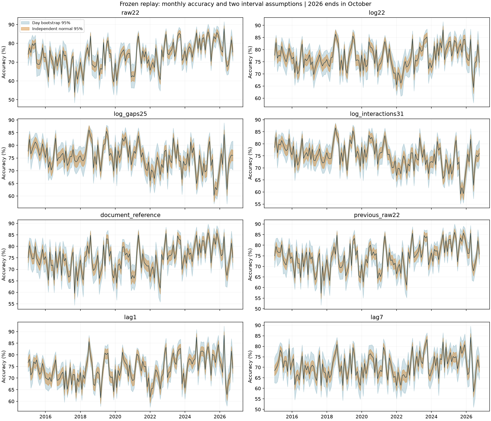

# Logistic Price Direction

预测 NSW 次日48档电价是否高于昨日均价。这里关心的不只是 Logistic 在2014年能拿到多高的分数，还包括：把同一个模型冻结十多年以后，这种优势是否还能保留。

实验从小组消融确定的22列特征出发，比较原始电价、有符号对数电价、历史价差和时段交互。分类器始终是 `StandardScaler + LogisticRegression`；变化的是输入表达、正则化、类别权重和决策阈值。

> 分工表状态见 [P4逐项核对](notes/p4_schedule_check.md)。模型实验已完成；P1正式v1接口、共享表写入和全组配置仍待交接确认。

## 两个结果需要分开看

| 配置 | 2014 BalAcc | 冻结回放 BalAcc | 冻结回放 Accuracy |
|---|---:|---:|---:|
| 原始22列参考 | 75.793% | 74.898% | 74.767% |
| 22列 + 类别权重 | 76.110% | 74.803% | 74.381% |
| `log22`：对数电价 | 77.032% | **75.698%** | **76.908%** |
| `log_gaps25`：再加历史价差 | 78.580% | 74.542% | 75.206% |
| `log_interactions31`：再加时段交互 | **79.125%** | 74.621% | 74.904% |
| 昨日同档基线 | 73.986% | 73.420% | 73.810% |
| 上周同档基线 | 74.282% | 70.416% | 70.806% |

2014用2010–2013训练的模型评分；回放用2010–2014重训后冻结的模型，覆盖2015年1月至2026年10月。它们的训练期、评估期都不同，不能直接把两列相减解释成模型退化幅度。

- **按2014选型，保留 `log_interactions31`。** 它比原始参考高3.332个百分点，但全期回放没有超过原始参考。
- **从回放结果看，`log22` 更好。** 它比昨日基线高2.278个百分点，但这是看过回放后的比较，不是重新声称它在2014获胜。

这两套模型都保存下来供组内比较。若利用回放成绩改变最终方案，回放就参与了选型，不能再作为独立测试。

完整8项对照（包括重新调参的原始22列）见 [2014结果](results/frozen/validation_2014.csv) 和 [回放汇总](results/frozen/overall.csv)。



图中蓝色为整日bootstrap区间，橙色为独立半小时正态近似区间。月度波动和区间宽度不等同于已检测到漂移。

## 从调参数到改特征

早期只搜索 `C`、`class_weight` 和阈值，2014 BalAcc最高为76.110%。扩大到2,070个候选后，按2013时间折选出的配置反而降至75.364%。因此后续实验转向价格变量的表达方式，而没有继续扩大网格。

`log22` 对5列历史价格统计使用 `sign(v) * log1p(abs(v))`，保留负价和零价；`log_gaps25` 再加入三种历史价格相对昨日均价的偏离；`log_interactions31` 让这些价差信号与时段的正弦、余弦相乘。

对入选31列模型做固定参数消融时，删除NSW历史及其派生价差/交互，BalAcc下降7.655个百分点；删除日历、28日统计分别下降0.817和0.788个百分点；删除QLD需求仅下降0.050个百分点。派生项随其来源一起删除，避免在交互项中留下已删除的信息。

[特征公式、时间划分与评分约定](notes/protocol.md) · [早期调参记录](notes/search_history.md) · [消融明细](results/frozen/selected_ablation_2014.csv)

## 在本地复现

从仓库根目录执行，使用 Python 3.11。课程CSV放在本地 `data/`，也可以通过 `--data` 指定其他路径。

```sh
python -m pip install -r logistic_price/requirements.txt

# 2013内部调参 → 2014方案选择 → 重训 → 冻结回放 → 图表
python -m logistic_price.study \
  --data data/nem_weather_halfhourly_2010_2026.csv \
  --output logistic_price/_scratch/reproduction

# 独立核对保存结果、时间轴、模型接口和特征边界
python -m logistic_price.verify \
  --data data/nem_weather_halfhourly_2010_2026.csv \
  --results logistic_price/_scratch/reproduction

# 不需要课程数据的功能测试
python -m logistic_price.selfcheck
```

程序拒绝覆盖已存在的输出目录；再次运行需换新目录名。`_scratch/` 已忽略，仓库内 `results/frozen/` 保留本次已核对的参考结果。

实际运行环境为Python 3.11.18，核心依赖与课程版本一致。1,152条特征方案调参记录、4,322天逐日检查，以及完整复跑一致性均已验证，详见 [检查记录](notes/checks.md)。

## 代码和结果各放在哪里

这里把可共用的计算放在模块里，由一个研究入口串联实验，不为每个变体复制一套训练脚本。

| 入口 | 职责 |
|---|---|
| `study.py` | 调参、选择、重训、回放与消融 |
| `features.py` / `transforms.py` | 历史特征与四种输入表达 |
| `tuning.py` | Logistic构造、基础评分、早期搜索复现 |
| `classifier.py` | 加载模型并预测新一天 |
| `scoring.py` / `diagnostics.py` | 汇总评分、区间、图表和交接预测表 |
| `verify.py` / `selfcheck.py` | 真实结果核对与合成数据测试 |
| `results/frozen/` | 本轮完整结果、逐档预测、图表及六套冻结模型 |
| `results/tuning_checks/` | 早期标准/扩展搜索记录，不重复保存旧环境工件 |

在 `results/frozen/` 中，`yearly.csv`、`monthly.csv` 分别保存年度和月度指标；`replay_predictions.csv.gz` 保存全部模型的逐档预测和概率；`protocol.json`、`selection_2013.json`、`selection_2014.json`、`run.json` 记录实验口径、选择和版本。原始CSV与本地运行环境不提交到本目录。

## 给其他模块调用

```python
from logistic_price.classifier import PriceClassifier

price_model = PriceClassifier(
    "logistic_price/results/frozen/artifacts/log_interactions31"
)
price_prediction = price_model.predict(history, weather_next)
```

输出为48行DataFrame，索引与 `weather_next.index` 一致，唯一列为整数 `nsw_price_up`。需要最近28个完整市场日的 `nsw_demand`、`nsw_price`、`qld_demand`；天气数值不参与计算，目标时间索引用于确定预测日。加载后不训练，预测时不访问网络或写文件。

比较长期回放候选时，将工件路径末段换成 `log22`。已有预测可直接取 [交互版](results/frozen/handoff_log_interactions31.csv.gz) 或 [对数版](results/frozen/handoff_log22.csv.gz)，字段为 `timestamp`、`nsw_price_up`、`price_up_probability`、`actual_price_up`，合并前应检查时间戳完全一致。

这些是冻结至2014年底的价格分类工件。它们不包含需求模型、在线漂移检测、适应策略或完整双目标 `Forecaster`。最终组内选型、统一特征接口、训练策略与官方提交检查仍需单独完成。

## 分工表对应的交接文件

`handoff/` 包含2014共享结果行、P4配置候选、年度类别比例图，以及实际训练后37–43天窗口；`milestones.py` 可重新生成。报告填充提纲、图表约定和live周分析框架在 `notes/`，详见 [分工核对表](notes/p4_schedule_check.md)。这些辅助文件不替代全组审批或公共配置。
